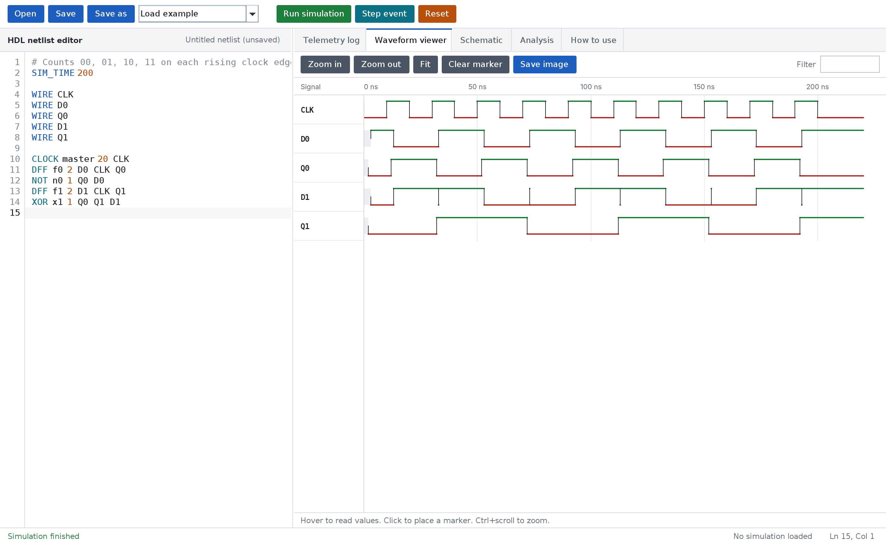
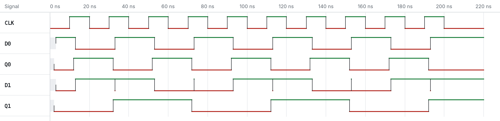
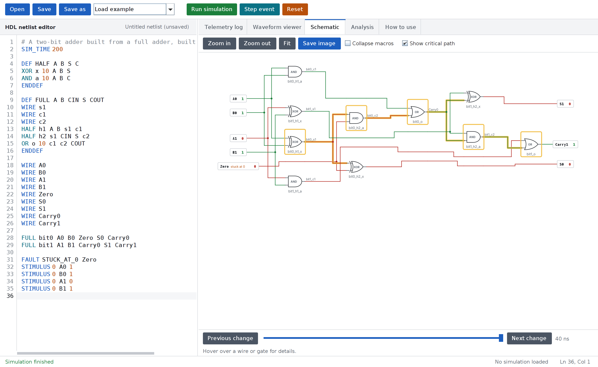

# Digital Circuit Simulator

An event-driven digital logic simulator written in object-oriented Java. Describe a circuit in a text netlist, then simulate it, view its waveform and schematic, analyze its timing, and test it for faults, from a desktop application, a browser, or the command line.

**[Open the browser version](https://msrishab007.github.io/DigitalCircuitSimulator/)**



The project implements the approach described in *Object Oriented Approach for Modeling Digital Circuits* (Dezan, Lagadec, Pottier). It was developed for the Object Oriented Analysis and Design course (SS G514) at BITS Pilani.

## Features

**Simulation**

- Discrete-event engine with per-gate propagation delays and four-state logic (0, 1, X, Z)
- Gates, buffers, D flip-flops, clocks, and custom Boolean function blocks
- Hierarchical macros, with a built-in library of adders, multiplexers, and decoders
- Stuck-at fault injection and timed assertions
- Single-event stepping for debugging

**Analysis**

- Static timing analysis that names the critical path and reports the maximum clock frequency
- Truth tables for combinational circuits and state tables for sequential circuits
- Equivalence checking with a counterexample
- Fault coverage reporting for your test stimuli
- Detection of combinational loops and conflicting drivers
- Resource counts

**Visualization and output**

- Interactive waveform viewer with zoom, filtering, and a measuring marker
- Automatically drawn schematic with wires colored by value at any point in time
- Collapsible macros and critical path highlighting on the schematic
- Waveform export as VCD or PNG, schematic export as PNG, and truth table export as CSV

## Getting started

### Browser

Open the [hosted version](https://msrishab007.github.io/DigitalCircuitSimulator/). No installation is needed.

### Build from source

You need JDK 21 or newer and Maven.

```shell
git clone https://github.com/MSRishab007/DigitalCircuitSimulator.git
cd DigitalCircuitSimulator
mvn clean package
```

This compiles the application, runs the test suite, and builds the browser engine.

Start the desktop application:

```shell
java -cp target/classes simulator.gui.SimulatorDashboard
```

Confirm that everything works:

```shell
java -cp target/classes simulator.Main check
```

To run the browser version locally, serve the repository folder and open `http://localhost:8000/`:

```shell
python -m http.server 8000
```

## Writing a netlist

A netlist declares wires, connects components to them, and describes the test. This half adder is checked with two assertions:

```text
# Half adder
SIM_TIME 100

WIRE A
WIRE B
WIRE Sum
WIRE Carry

XOR sum_gate 10 A B Sum
AND carry_gate 10 A B Carry

STIMULUS 0 A 1
STIMULUS 0 B 1

ASSERT 50 Sum 0
ASSERT 50 Carry 1
```

### Commands

| Command | Meaning |
|---|---|
| `SIM_TIME 100` | Run for 100 ns |
| `WIRE A` | Declare a wire |
| `STIMULUS 0 A 1` | Drive wire `A` to `1` at 0 ns. Values are `0`, `1`, or `Z` |
| `ASSERT 50 Sum 0` | Check a wire's value at 50 ns and report PASS or FAIL. Values are `0`, `1`, `X`, or `Z` |
| `FAULT STUCK_AT_0 A` | Hold a wire at 0 for the whole run. `STUCK_AT_1` holds it at 1 |
| `DEF NAME ports...` ... `ENDDEF` | Define a reusable macro, which can use other macros |
| `# text` | Comment, on its own line or after a command |

### Components

| Component | Form |
|---|---|
| `AND`, `OR`, `NAND`, `NOR`, `XOR`, `XNOR` | `AND id delay in1 in2 out` |
| `NOT` | `NOT id delay in out` |
| `BUFFER` (tri-state) | `BUFFER id delay in enable out` |
| `DFF` | `DFF id delay d clock q` |
| `CLOCK` | `CLOCK id period out` |
| `FUNC` | `FUNC id delay inputs... out = expression` |
| `HALF_ADDER`, `FULL_ADDER`, `MUX2`, `DECODER2` | Library macros: `HALF_ADDER id A B SUM CARRY` |

The **How to use** tab in the desktop and browser applications has the full reference, with worked examples. It is also available from the command line through the `guide` command.

## Command line

Each command follows `java -cp target/classes simulator.Main`.

| Command | Description |
|---|---|
| `simulate <netlist> [output.vcd]` | Run the circuit and write the waveform |
| `waveform-image <netlist> <output.png>` | Run the circuit and save the waveform as an image |
| `validate <netlist>` | Check syntax, loops, and conflicting drivers without running |
| `analyze <netlist>` | Report the critical path, maximum clock frequency, and resources |
| `truth-table <netlist> [inputs outputs]` | Print a truth table or state table |
| `equivalent <a> <b> [inputs outputs]` | Compare two circuits and show the first difference |
| `fault-coverage <netlist>` | Report which stuck-at faults the stimuli detect |
| `check` | Run the built-in self-check |
| `guide` | Print the user guide |

Inputs and outputs are comma-separated wire names. They are detected from the circuit when omitted.

A command exits with status 0 on success and 1 on failure, including a failed assertion. `equivalent` exits with status 2 when the circuits differ, which makes these commands suitable for scripts and CI.

## Samples

The [`samples`](samples) folder contains example netlists. Their outputs are in [`samples/waveforms`](samples/waveforms), both as images and as VCD files that open in viewers such as GTKWave.

| Netlist | Demonstrates |
|---|---|
| `half_adder.netlist` | Gate-level half adder driven through every input combination |
| `full_adder.netlist` | Full adder built from a macro |
| `two_bit_counter.netlist` | Sequential logic with a clock and flip-flops |
| `dff_test.netlist` | Flip-flop behavior with a stuck-at fault on its input |
| `testbench.netlist` | Tri-state buffer releasing its output to `Z` |

Waveform of the two-bit counter:



Schematic of a two-bit adder built from macros, with its critical path highlighted:



## Architecture

The desktop application, command line, and browser all run the same engine through `SimulationApplicationService`. The browser version is produced by compiling the Java engine to JavaScript with [TeaVM](https://teavm.org/).

| Package | Responsibility |
|---|---|
| `simulator.core` | Wires, pins, signal states, and the base component |
| `simulator.components` | Gates, flip-flops, clocks, function blocks, and modules |
| `simulator.engine` | Event queue, timing, truth tables, equivalence, and fault coverage |
| `simulator.parser` | Netlist parsing, component creation, and topology validation |
| `simulator.schematic` | Schematic layout and resource counting |
| `simulator.fault` | Stuck-at fault injection |
| `simulator.io` | VCD output |
| `simulator.application` | Shared services, examples, user guide, and self-check |
| `simulator.gui` | Swing desktop application |

### Design patterns

| Pattern | Where it is used |
|---|---|
| Observer | `Wire` notifies its connected `InputPin` objects and the waveform logger when its value changes |
| Composite | `Module` holds gates and nested modules, forming the macro hierarchy |
| Factory | `ComponentFactory` creates components from their netlist names |
| State | `SequentialComponent` delegates its stored value to `MemoryState` implementations |
| Facade | `SimulationFacade` and `SimulationApplicationService` give clients a small interface to the engine |
| Dependency injection | `SimulationContext` owns the event engine for one run and is passed to the components that need it, so runs stay independent |

The class and activity diagrams are in [`docs/OOAD_Project_Document_1`](docs/OOAD_Project_Document_1).

## Testing

```shell
mvn test
java -cp target/classes simulator.Main check
node scripts/browser-smoke-test.js
```

These run the JUnit suite, the self-check of each major feature, and a test of the compiled browser engine. GitHub Actions runs the build and the browser engine test on every push, and publishes the browser version to GitHub Pages from `main`.

`mvn test` also measures test coverage with [JaCoCo](https://www.jacoco.org/jacoco/). Open `target/site/jacoco/index.html` to see the results for each package.

## Known limitations

- Wires carry a single bit. Multi-bit buses and integer truth tables are not supported.
- Macros form a real hierarchy for structure and display, but simulation runs on the expanded gates.
- FPGA placement and LUT mapping from the original paper are not implemented.
- Truth tables allow at most 16 inputs and flip-flops combined.
